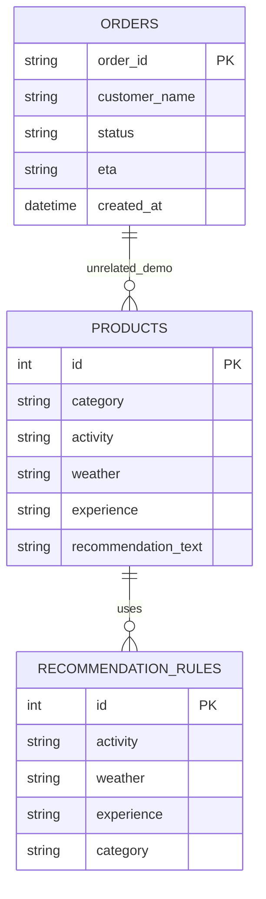

# DATABASE_DESIGN.md

# NorthStar AI Customer Support Chatbot
## Database Design Specification

Version: 1.0

---

# Purpose

The database layer provides all persistent business data for the chatbot while remaining completely independent from the user interface, NLP engine, and business services.

The chatbot must never communicate directly with SQLite or any future database implementation. All access occurs through the Data Access Layer (DAL).

---

# Design Goals

- Offline by default
- Replaceable storage backend
- Simple demo data
- Production-ready schema
- ORM-friendly
- Easy migration to enterprise systems

---

# Database Architecture

```text
Conversation Manager
        │
        ▼
 Business Services
        │
        ▼
 Repository Interface
        │
        ▼
 Database Adapter
        │
        ▼
 SQLite (Current)

Future:
PostgreSQL
MySQL
MongoDB
REST API
Enterprise OMS
```

---

# Entity Relationship Diagram



> Note: The entities are intentionally decoupled. Product recommendations are independent of order tracking.

---

# Tables

## orders

Purpose

Stores customer order status.

Columns

| Column | Type | Description |
|---------|------|-------------|
| order_id | TEXT | Primary Key |
| customer_name | TEXT | Demo customer |
| status | TEXT | Processing / Shipped / Delivered |
| eta | TEXT | Expected delivery |
| created_at | DATETIME | Record creation |

---

## products

Purpose

Stores recommendation categories.

Columns

| Column | Type |
|---------|------|
| id | INTEGER |
| category | TEXT |
| activity | TEXT |
| weather | TEXT |
| experience | TEXT |
| recommendation_text | TEXT |

Example

Camping

Cold

↓

Sleeping Bag

---

## recommendation_rules

Purpose

Maps user preferences to product categories.

Example

| Activity | Weather | Experience | Category |
|-----------|----------|------------|----------|
| Camping | Cold | Beginner | Sleeping Bag |
| Hiking | Rainy | Intermediate | Rain Jacket |
| Trekking | Snow | Advanced | Insulated Boots |

---

# Seed Data

## Orders

| Order | Status | ETA |
|--------|--------|-----|
|111|Shipped|Arriving Tomorrow|
|222|Processing|Ships in 24 Hours|
|333|Delivered|Delivered|

Any other order should return "Invalid Order".

---

## Product Categories

- Tents
- Sleeping Bags
- Hiking Boots
- Rain Jackets
- Backpacks
- Insulated Jackets

---

# Repository Contract

Every adapter must implement:

```python
get_order(order_id)

get_products(filters)

get_recommendations(activity, weather, experience)
```

The Conversation Manager interacts only with these methods.

---

# SQLAlchemy Models

The ORM layer should contain:

```
models/
    order.py
    product.py
    recommendation_rule.py
```

Business services must never execute raw SQL.

---

# Adapter Pattern

Current

```
SQLiteAdapter
```

Future

```
PostgresAdapter

MongoAdapter

CompanyAPIAdapter
```

Every adapter implements the same interface.

---

# Index Strategy

Indexes

orders.order_id

products.activity

products.weather

recommendation_rules.activity

recommendation_rules.weather

These indexes are sufficient for the expected workload.

---

# Migration Strategy

Phase 1

SQLite

↓

Phase 2

PostgreSQL

↓

Phase 3

REST API

Only the adapter changes.

No service logic should change.

---

# Validation Rules

Orders

- order_id required
- unique
- status required

Products

- category required
- activity required

Recommendation Rules

- activity required
- weather optional
- experience optional

---

# Example Queries

Retrieve Order

```sql
SELECT *
FROM orders
WHERE order_id = ?
```

Retrieve Recommendations

```sql
SELECT category
FROM recommendation_rules
WHERE activity = ?
AND weather = ?
```

---

# Configuration

```python
DATABASE_BACKEND = "sqlite"
```

Future

```python
DATABASE_BACKEND = "postgres"
```

No other code changes required.

---

# Future Enhancements

- Inventory table
- Customers table
- Shipping providers
- Warehouse locations
- Product inventory
- Order history
- Analytics tables

---

# Definition of Success

The database layer is successful when:

- SQLite satisfies the demo.
- Adapters are interchangeable.
- Services remain database-agnostic.
- Business logic contains no SQL.
- Future integrations require only a new adapter implementation.
